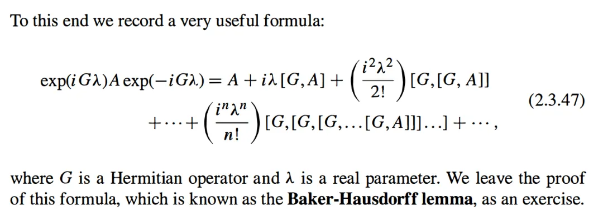
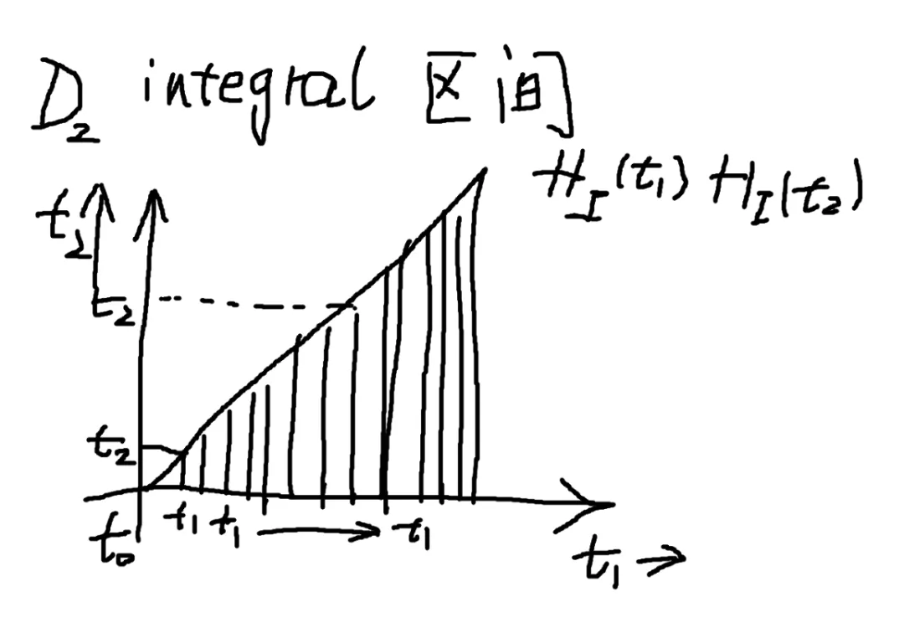
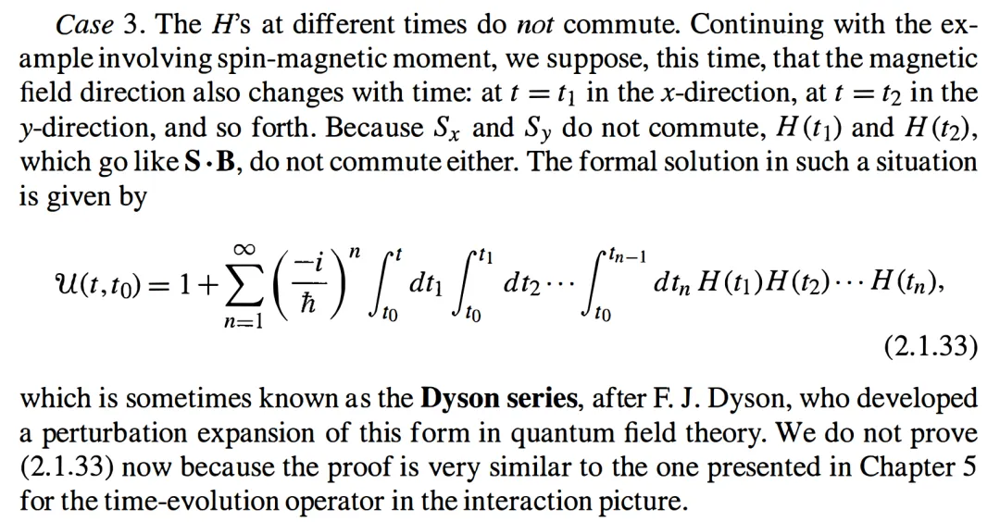

## 1. 相互作用绘景

本文采用自然单位制，$\hbar =1$。本文仅导出这两个级数，未对其物理意义作过多说明。

回顾薛定谔绘景：态动，算符不动：$|\psi(t)\rangle_S =e^{-iH(t-t_0)}|\psi(t_0)\rangle_S$，$e^{-iH(t-t_0)}$ 就是时间演化算符。

海森堡绘景：算符动，态不动：$O_H(t) =e^{iH(t-t_0)}O_Se^{-iH(t-t_0)}$，态的变化是$|\psi\rangle_H=e^{iH(t-t_0)}|\psi(t)\rangle_S=|\psi(t_0)\rangle_S$（转回去）。

相互作用绘景，就是把哈密顿量 $H$ 写成以下形式：
$$
H = H_0 + H_{int}
$$
其中 $H_0$ 不含时，$H_{int}$ 为相互作用项。仿照海森堡绘景，相互作用绘景和薛定谔绘景的关系是：
$$
|\psi(t)\rangle_I=e^{iH_0t}|\psi(t)\rangle_S
$$
我们这么做的原因是 $H_0$ 不含时。现在我们关心的是态的演化，相互作用绘景的时间演化是如何的？我们把相互作用绘景的时间演化算符记作$U(t,t_0)$ ，下面来求它。

首先，从$t_0$演化到$t$，有：
$$
|\psi(t)\rangle_I = U(t, t_0)|\psi(t_0)\rangle
$$
把相互作用的ket统一换成薛定谔绘景的：
$$
e^{iH_0t}|\psi(t)\rangle_S
=U(t,t_0)
e^{iH_0t_0}|\psi(t_0)\rangle_S
$$
左乘$e^{-iH_0t}$：
$$
|\psi(t)\rangle_S=
e^{-iH_0t}U(t,t_0)e^{iH_0t_0}
|\psi(t_0)\rangle_S
$$
代入$|\psi(t)\rangle_S =U_S(t,t_0)|\psi(t_0)\rangle_S$，消掉$|\psi(t_0)\rangle_S$，得到：
$$
U_S(t,t_0)=
e^{-iH_0t}U(t,t_0)e^{iH_0t_0}
$$
我们求出相互作用绘景的时间演化算符，如果$H_{int}$不含时（显含时间时一般需要写成时间排序指数），$U_S(t,t_0)=e^{-i(H_0+H_{int})(t-t_0)}$就是：
$$
U(t,t_0)=
e^{iH_0t}e^{-i(H_0+H_{int})(t-t_0)}e^{-iH_0t_0}
$$
之所以这么长，是因为$[H_0,H_{int}]\ne 0$，否则它就会变回$e^{-iH_{int}(t-t_0)}$的形式，QFT就会简单得多。

如果$H_{int}$含时，那么还需要考虑不同时刻的$H_{int}$是否对易。

我们把求得的时间演化算符代入薛定谔方程：
$$
i\frac{\partial}{\partial t}U_S(t,t_0)
=
H_S(t)U_S(t,t_0)
$$
代入下式，$U(t,t_0)$对时间求导数：
$$
U(t,t_0)=e^{iH_0t}U_S(t,t_0)e^{-iH_0t_0}
$$
最后得到：
$$
i\frac{\partial}{\partial t}U(t,t_0) = H_I(t)U(t,t_0)\\
H_I(t)\equiv e^{iH_0t}H_{\mathrm{int}}(t)e^{-iH_0t}
$$

## 2. Magnus 级数

由于$[H_0,H_{int}]\ne 0$，这个 $H_I$ 指数不好处理，不过我们想到Baker-Hausdorff 引理可以计算这个样子的乘积。

这个式子见于Sakurai 《现代量子力学》，式(2.3.47)：
$$
e^{iG\lambda}Ae^{-iG\lambda} =\sum_{n=0}^{\infty}\frac{(i\lambda)^n}{n!} \underbrace{[G,[G,\ldots,[G,A]]]}_{n\text{ 个 }G}
$$
它的特点是$A$被两个互相共轭的指数夹在一起，我们可以直接算$H_I(t)$：
$$
\begin{aligned}
H_I(t)
={}&H_{\mathrm{int}}(t)
+it[H_0,H_{\mathrm{int}}(t)]\\
&+\frac{(it)^2}{2!}
[H_0,[H_0,H_{\mathrm{int}}(t)]]+\cdots
\end{aligned}
$$
这告诉我们，相互作用绘景哈密顿量的时间依赖可以表示为一系列嵌套对易子。下面我们尝试来求$U(t,t_0)$。

上一节写到：
$$
i\frac{\partial}{\partial t}U(t,t_0) = H_I(t)U(t,t_0)
$$
我们记$A(t)=-iH_I(t)$，上式变为：
$$
\frac{dU}{dt}=A(t)U
$$
时间演化算符是幺正的，我们设一个试解，它有如下的形式：
$$
U(t,t_0)=e^{\Omega(t)}
$$
它的时间演化为：
$$
\frac{d}{dt}e^{\Omega(t)}=A(t)e^{\Omega(t)}
$$
但是现在问题是，这个式子的左边不能写成$\dot \Omega e^\Omega$，因为$\Omega$是个矩阵（在表示下），有：

$$
e^\Omega=I+\Omega+\frac{\Omega^2}{2!}+\cdots
$$

其中平方项的导数是

$$
\frac{d}{dt}\Omega^2 =\dot\Omega\Omega+\Omega\dot\Omega
$$

而不一定是 $2\Omega\dot\Omega$。一般而言$[\dot \Omega, \Omega] \ne0$。

矩阵指数的导数（证明参考：arXiv:0810.5488，Lemma 2，以及`scipp-legacy.pbsci.ucsc.edu/~haber/webpage/MatrixExpLog.pdf`）由下式计算：
$$
\frac{d}{dt}e^\Omega
=
\int_0^1 ds\,
e^{s\Omega}\dot\Omega e^{(1-s)\Omega}
$$
在这个公式的右边乘上 \(e^{-\Omega}\)：
$$
A(t)=\left(\frac{d}{dt}e^\Omega\right)e^{-\Omega} = \int_0^1 ds\,e^{s\Omega}\dot\Omega e^{-s\Omega}
$$
**注意到**右边有$e^{s\Omega}\dot\Omega e^{-s\Omega}$的结构，正好可以用前面的BH引理，代入得：
$$
\begin{aligned}
e^{s\Omega}\dot\Omega e^{-s\Omega}
={}&\dot\Omega+s[\Omega,\dot\Omega]\\
&+\frac{s^2}{2!}[\Omega,[\Omega,\dot\Omega]]\\
&+\cdots
\end{aligned}
$$
代入刚才的积分：
$$
A(t)=\int_0^1 ds\,\Big( \dot\Omega+s[\Omega,\dot\Omega]+\frac{s^2}{2!}[\Omega,[\Omega,\dot\Omega]] +\cdots\Big)
$$
这个积分是可以算出来的，利用幂级数的积分：
$$
\int x^n\,dx=\frac{x^{n+1}}{n+1}+C
$$

最后算出来得：
$$
A(t)=\dot\Omega
+\frac12[\Omega,\dot\Omega]
+\frac16[\Omega,[\Omega,\dot\Omega]]
+\cdots
$$
这个$\Omega(t)$ 可以写成一个级数展开，称作 **Magnus 级数**（见arXiv:1401.2979）：
$$
\Omega(t)=\sum_{n=1}^\infty\,\Omega_n(t)
$$

这个级数的好处是可以把前一项代入后一项，后面在 Dyson 级数中也有类似的处理，我们先看它的前几项：

* 保留到一阶：
  $$
  A(t)=\dot \Omega_1(t)
  $$
  有：
  $$
  \Omega_1(t)=\int_{t_0}^tdt_1\,A(t_1)
  $$

* 保留到二阶：
  $$
  A=
  \dot\Omega_1+\dot\Omega_2
  +\frac12[\Omega_1,\dot\Omega_1]
  $$
  由于 $\dot\Omega_1=A$，因此有：
  $$
  \dot\Omega_2 =-\frac12[\Omega_1,A(t)]
  $$
  代入$\Omega_1(t)$，得到：
  $$
  \dot\Omega_2
  =\frac12\int_{t_0}^{t}dt_1\,
  [A(t),A(t_1)]
  $$
  对时间积分，注意这里的积分变量是$t_2$了，上下限是$t_0$到$t_1$：
  $$
  \Omega_2(t)=
  \frac12\int_{t_0}^{t}dt_1
  \int_{t_0}^{t_1}dt_2\,
  [A(t_1),A(t_2)]
  $$

* 保留到三阶，可以利用 Jacobi 恒等式，整理后的结果是（arXiv:0810.5488，式45）：
  $$
  \Omega_3(t)
  ={}\frac16\int_{t_0}^{t}dt_1
  \int_{t_0}^{t_1}dt_2
  \int_{t_0}^{t_2}dt_3
  \left([A(t_1),[A(t_2),A(t_3)]]
  +[A(t_3),[A(t_2),A(t_1)]]\right)
  $$

回到最初，时间演化算符就可以写成：
$$
U(t,t_0)=
\exp\left(\sum_{n=1}^{\infty}\Omega_n(t)\right)
$$

## 3. Dyson 级数

换一种思路，我们直接解最初的时间演化方程，不去凑指数的形式：
$$
i\frac{dU(t,t_0)}{dt}=H_I(t)U(t,t_0)
$$
直接对这个式子积分，为避免和$U$里的变量与积分上限混淆，把积分变量设成$t_1$:
$$
i\int_{t_0}^tdt_1\,\frac{dU}{dt_1}=
\int_{t_0}^tdt_1\,H_I(t_1)U(t_1,t_0)
$$
$U(t_0,t_0)=1$，有：
$$
U(t,t_0)=1-i\int_{t_0}^{t}dt_1\,H_I(t_1)U(t_1,t_0)
$$
我们把$U$解出来了，但是注意到这个式子左右两边都有$U$，我们可以把括号里的$t$换成$t_1$，然后代入右侧：
$$
U(t_1,t_0) =1-i\int_{t_0}^{t_1}dt_2\,H_I(t_2)U(t_2,t_0)
$$
代入得：
$$
\begin{aligned}
U(t,t_0)
&= 1-i\int_{t_0}^{t}dt_1\,H_I(t_1)\\
&\qquad\times\left[
    1-i\int_{t_0}^{t_1}dt_2\,
    H_I(t_2)U(t_2,t_0)
\right]\\
&= 1-i\int_{t_0}^{t}dt_1\,H_I(t_1)\\
&\qquad+(-i)^2
    \int_{t_0}^{t}dt_1
    \int_{t_0}^{t_1}dt_2\,
    H_I(t_1)H_I(t_2)U(t_2,t_0)
\end{aligned}
$$
同理，把$U(t_2)$代入：
$$
\begin{aligned}
U(t,t_0)
&=1-i\int_{t_0}^{t}dt_1\,H_I(t_1)\\
&\quad+(-i)^2\int_{t_0}^{t}dt_1
\int_{t_0}^{t_1}dt_2\,H_I(t_1)H_I(t_2)\\
&\qquad\times\left[
1-i\int_{t_0}^{t_2}dt_3\,H_I(t_3)U(t_3,t_0)
\right]\\
&=1-i\int_{t_0}^{t}dt_1\,H_I(t_1)\\
&\quad+(-i)^2\int_{t_0}^{t}dt_1
\int_{t_0}^{t_1}dt_2\,H_I(t_1)H_I(t_2)\\
&\quad+(-i)^3\int_{t_0}^{t}dt_1
\int_{t_0}^{t_1}dt_2
\int_{t_0}^{t_2}dt_3\\
&\qquad\times H_I(t_1)H_I(t_2)H_I(t_3)U(t_3,t_0)
\end{aligned}
$$
迭代$n$次，得到结果为：
$$
\begin{aligned}
U(t,t_0)=\sum_{n=0}^{\infty}(-i)^n
&\int_{t_0}^{t}dt_1
\int_{t_0}^{t_1}dt_2\cdots\\
&\int_{t_0}^{t_{n-1}}dt_n\,
H_I(t_1)\cdots H_I(t_n)
\end{aligned}
$$
注意这个嵌套的积分上下限满足：$t\ge t_1\ge t_2\ge\cdots\ge t_n\ge t_0$，排序自动出现，时间大的永远在左面，以二阶为例：
$$
D_2= \int_{t_0}^{t}dt_1 \int_{t_0}^{t_1}dt_2\, H_I(t_1)H_I(t_2)
$$
$t_1 > t_2$，这个积分只覆盖正方形积分区域的一半。

引入时间排序算符$T$：
$$
T[H_I(t_1)H_I(t_2)] = \begin{cases} H_I(t_1)H_I(t_2),&t_1>t_2\\ H_I(t_2)H_I(t_1),&t_2>t_1 \end{cases}
$$
如果不管顺序，时间排序后，两个三角形的积分贡献相同，整个正方形可分成两个时间顺序相反的三角形：
$$
\begin{aligned} &\int_{t_0}^{t}dt_1\int_{t_0}^{t}dt_2\,
T[H_I(t_1)H_I(t_2)]\\ &=2\int_{t_0}^{t}dt_1\int_{t_0}^{t_1}dt_2\, H_I(t_1)H_I(t_2) \end{aligned}
$$
（注意：左边的两个积分上下限都是 \(t_0\) 到 \(t\)，不是第二个积分到 \(t_1\)。）

推广到$n$阶，有如下通项：
$$
U(t,t_0)=\sum_{n=0}^{\infty}\frac{(-i)^n}{n!} \int_{t_0}^{t}dt_1\cdots \int_{t_0}^{t}dt_n\, 
T[H_I(t_1)\cdots H_I(t_n)]
$$
利用$e$指数的展开，可以把上式写成如下形式：
$$
U(t,t_0)=
T\exp\left(-i\int_{t_0}^{t}dt'\,H_I(t')\right)
$$
如果不考虑时间排序，把上式的$T$擦掉，我们发现这就是普通指数形式（参见Sakurai书，式（2.1.32），讨论了几种哈密顿量的形式），但由于不同时刻的哈密顿量一般不对易，普通指数并不一定满足薛定谔方程，所以必须引入时间排序算符。

如此看来，Dyson级数为算符乘积的和，而Magnus级数是一个指数，指数中包含嵌套对易子。一般来说Dyson 展开通常比 Magnus 展开更实用，因为它可以结合 Wick 定理计算，Dyson 级数在有限维量子系统中，对有限时间区间内可积的哈密顿量总是收敛的，而 Magnus 级数不一定收敛（参见：arXiv:0711.2381）。

