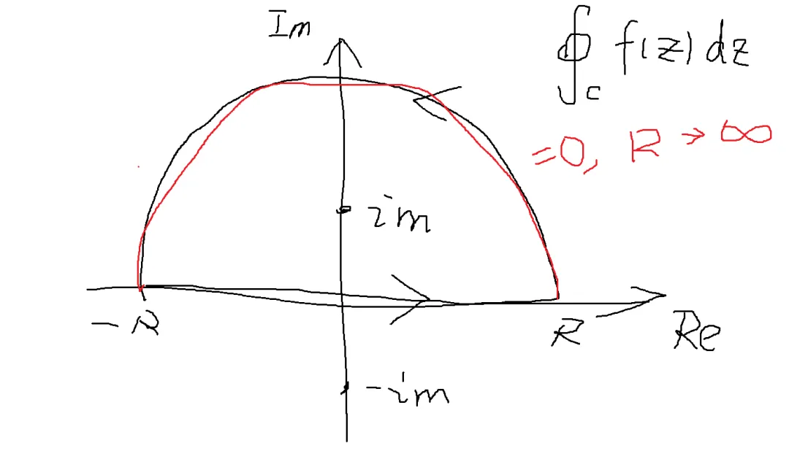

## 1. 库仑势

电磁场的拉氏量密度为：
$$
\mathcal L = -\frac{1}{4}F^2_{\mu \nu}-A_\mu J^\mu\\
F^{\mu\nu}\equiv\partial^\mu A^\nu-\partial^\nu A^\mu
$$
把 $F_{\mu\nu}$ 展开，交换偏导数顺序，更改角标后，得：
$$
\mathcal L = -\frac{1}{2}(\partial_\mu A_\nu)(\partial^\mu A^\nu)+\frac{1}{2}(\partial_\mu A_\nu)(\partial^\nu A^\mu)-A_\mu J^\mu
$$

**注意到：**
$$
\begin{aligned}
&\partial_\mu\left(A_\nu\partial^\nu A^\mu-A^\mu\partial_\nu A^\nu\right)\\
&=(\partial_\mu A_\nu)(\partial^\nu A^\mu)
\cancel{+A_\nu\partial_\mu\partial^\nu A^\mu}
-(\partial_\mu A^\mu)(\partial_\nu A^\nu)
\cancel{-A^\mu\partial_\mu\partial_\nu A^\nu}\\
&=(\partial_\mu A_\nu)(\partial^\nu A^\mu)
-(\partial_\mu A^\mu)^2
\end{aligned}
$$

**注意到**这是一个全导数，在通常的变分边界条件下不影响E–L方程，可以忽略。所以：
$$
\mathcal L
=-\frac12(\partial_\mu A_\nu)(\partial^\mu A^\nu)
+\frac12(\partial_\mu A^\mu)^2
-J_\mu A^\mu
$$
对它应用E-L方程即可。
$$
\frac{\partial \mathcal L}{\partial A_\nu}-\partial_\mu \left( \frac{\partial\mathcal L}{\partial(\partial_\mu A_\nu)}\right)=0
$$
第一项：
$$
\frac{\partial\mathcal L}{\partial A_\nu}=-J^\nu
$$
第二项，第一部分，先把dummy indices改为$\alpha$与$\beta$：
$$
\frac{\partial}{\partial(\partial_\mu A_\nu)}
\left[(\partial_\alpha A_\beta)(\partial^\alpha A^\beta)\right]
=2\partial^\mu A^\nu
$$
第二项，第二部分：
$$
\begin{aligned}
\frac{\partial}{\partial(\partial_\mu A_\nu)}
(\partial_\alpha A^\alpha)^2
&=2(\partial_\alpha A^\alpha)
\frac{\partial(\partial_\beta A^\beta)}{\partial(\partial_\mu A_\nu)}\\
&=2(\partial_\alpha A^\alpha)g^{\mu\nu}
\end{aligned}
$$
全部带回，得：
$$
-J^\nu+\partial_\mu\partial^\mu A^\nu
-\partial^\nu\partial_\mu A^\mu=0
$$
结合对$F^{\mu \nu}$定义，**注意到**：
$$
\partial_\mu F^{\mu\nu}
=\partial_\mu\partial^\mu A^\nu-\partial_\mu\partial^\nu A^\mu
$$
所以，只需要解这个方程：
$$
J^\nu=\partial_\mu F^{\mu\nu}=\Box A^\nu-\partial^\nu(\partial_\mu A^\mu)
$$
即可。这里的方块叫d'Alembertian，$\Box\equiv\partial_\mu\partial^\mu=\partial_t^2-\nabla^2$。

使用Lorenz gauge，有$\partial_\mu A^\mu=0$，于是方程变为：
$$
J^\nu=\Box A^\nu
\quad\Longrightarrow\quad
A_\nu(x)=\frac1\Box J_\nu(x)
$$
$1/\Box$： the inverse of $\Box$。注意，$A_\nu$ is a field，$J_\nu$ is a source。$1/\Box$ propagates the source，which has the name **propagator**。（格林函数需要指定边界条件，以下取静态、无额外自由场、无穷远处势为零的解。也就是Dyson展开的第一项，费曼图的第一项）

因为库仑势是静止点电荷产生的，所以$J^\mu=(e\delta^{(3)}(\boldsymbol{x}),\boldsymbol{0})$，代入得
$$
A_0(\boldsymbol{x})=\frac{e}{\Box}\delta^{(3)}(\boldsymbol{x}),
\qquad A_i=0
$$
下面求解这个方程。首先，静态情况下$\partial_tA_\mu=0$，因此$\Box=-\nabla^2$，求解：
$$
A_0(\boldsymbol{x})
=\frac{e}{-\nabla^2}\delta^{(3)}(\boldsymbol{x})
$$
因为delta函数的Fourier变换为1，我们把函数变换到动量空间：
$$
\delta^{(3)}(\boldsymbol{x})
=\int\frac{d^3k}{(2\pi)^3}e^{i\boldsymbol{k}\cdot\boldsymbol{x}}\\
A_0(\boldsymbol{x})
=\int\frac{d^3k}{(2\pi)^3}\widetilde A_0(\boldsymbol{k})e^{i\boldsymbol{k}\cdot\boldsymbol{x}}\\
\nabla^2e^{i\boldsymbol{k}\cdot\boldsymbol{x}}
=-|\boldsymbol{k}|^2e^{i\boldsymbol{k}\cdot\boldsymbol{x}}
$$
发现：
$$
\nabla^2\delta^{(3)}(\boldsymbol{x})
=\int\frac{d^3k}{(2\pi)^3}
\bigl(-|\boldsymbol{k}|^2\bigr)e^{i\boldsymbol{k}\cdot\boldsymbol{x}}
$$
因此，每作用一个$\nabla^2$，在动量空间中就多乘一个$-|\boldsymbol{k}|^2$。类似，四维 Fourier transform 中有$\Box\leftrightarrow-k_\mu k^\mu$。

全部代入，得到：
$$
\cancel{\int\frac{d^3k}{(2\pi)^3}}
|\boldsymbol{k}|^2\widetilde A_0(\boldsymbol{k})\cancel{e^{i\boldsymbol{k}\cdot\boldsymbol{x}}}
=e\cancel{\int\frac{d^3k}{(2\pi)^3}e^{i\boldsymbol{k}\cdot\boldsymbol{x}}}
$$
换回坐标空间：
$$
A_0(\boldsymbol{x})
=e\int\frac{d^3k}{(2\pi)^3}
\frac{e^{i\boldsymbol{k}\cdot\boldsymbol{x}}}{|\boldsymbol{k}|^2}
$$
下面求这个积分就可以。换成球坐标求它：令$r=|\boldsymbol{x}|$、$k=|\boldsymbol{k}|$，选择动量空间球坐标的极轴沿$\boldsymbol{x}$方向，则$\boldsymbol{k}\cdot\boldsymbol{x}=kr\cos\theta$。
$$
\begin{aligned}
A_0(\boldsymbol{x})
&=\int\frac{d^3k}{(2\pi)^3}\frac{e}{k^2}e^{i\boldsymbol{k}\cdot\boldsymbol{x}}\\
&=\frac{e}{(2\pi)^3}
\int_0^\infty dk\,\frac{k^2}{k^2}
\underbrace{\int_0^{2\pi}d\varphi}_{2\pi}
\underbrace{\int_0^\pi d\theta\,\sin\theta\,e^{ikr\cos\theta}}_{\frac{2\sin(kr)}{kr}}
\end{aligned}
$$
所以有：
$$
A_0(\boldsymbol{x})
=\frac{2e}{(2\pi)^2r}
\int_0^\infty dk\,\frac{\sin(kr)}{k}
$$
最右边的积分叫作 Dirichlet integral （$r>0$），它可以用复变函数的积分（用留数定理，对上半圆路径积分，极点位于原点，抠掉极点，半圆外周长根据Jordan引理为0，剩下两段），也可以用拉普拉斯变换求（更简单），总之结果为：
$$
\int_0^\infty dk\,\frac{\sin(kr)}{k}=\frac\pi2
$$
全部代入后就求出库仑势：
$$
A_0(\boldsymbol{x})=\frac{e}{4\pi r}
$$
形式解 $A_\mu=\Box^{-1}J_\mu$ 就包含了这个计算。$J_\mu$ 可以具有任意形式，但作为 Maxwell 方程的源必须满足电流守恒 $\partial_\mu J^\mu=0$。

库仑定律：$\boldsymbol{E}=-\boldsymbol{\nabla}A_0=\dfrac{e}{4\pi r^2}\hat{\boldsymbol r}$

## 2. 汤川（Yukawa）势：

通常被称作库仑势的有质量版本。拉氏量密度写作：
$$
\mathcal L=-\frac14F_{\mu\nu}F^{\mu\nu}
+\frac12m^2A_\mu A^\mu-A_\mu J^\mu
$$
也就是刚才的拉氏量加了一项，整理后是：
$$
\mathcal L = -\frac{1}{2}(\partial_\mu A_\nu)(\partial^\mu A^\nu)+\frac{1}{2}(\partial_\mu A_\nu)(\partial^\nu A^\mu)+\frac12m^2A_\mu A^\mu-A_\mu J^\mu
$$

点源是静态的，取：
$$
J^\mu=(\rho,\boldsymbol{0}),
\qquad
\rho(\boldsymbol{r})=g\delta^{(3)}(\boldsymbol{r})
$$

与第一部分一样，忽略全导数后，拉氏量也可以写成：
$$
\mathcal L
=-\frac12(\partial_\mu A_\nu)(\partial^\mu A^\nu)
+\frac12(\partial_\mu A^\mu)^2
+\frac12m^2A_\mu A^\mu-A_\mu J^\mu
$$
质量项不含场的导数，所以 E–L 方程的第二项与前面相同，第一项变为：
$$
\frac{\partial\mathcal L}{\partial A_\nu}
=m^2A^\nu-J^\nu
$$
全部带回，得：
$$
-J^\nu+m^2A^\nu+\partial_\mu\partial^\mu A^\nu
-\partial^\nu\partial_\mu A^\mu=0
$$
这个方程叫Proca方程：
$$
J^\nu=(\Box+m^2)A^\nu-\underbrace{\partial^\nu(\partial_\mu A^\mu)}_{0}
$$

下面说明，在现在的条件下，第二项为什么为零。这里不能像无质量时那样任意选择Lorenz gauge。**注意到**，对 Proca 方程两边作用 $\partial_\nu$：
$$
\partial_\nu\Big(-J^\nu+m^2A^\nu+
\underbrace{\partial_\mu\partial^\mu A^\nu-\partial^\nu\partial_\mu A^\mu}_{\partial_\nu(\partial_\mu F^{\mu\nu})=0}
\Big)=0
$$
作用后剩下两项：
$$
m^2\partial_\nu A^\nu=\partial_\nu J^\nu
$$
对这里的静态点源，$\partial_\nu J^\nu=0$，且 $m\ne0$，所以必须有$\partial_\nu A^\nu=0$。于是方程变为：
$$
J^\nu=(\Box+m^2)A^\nu
$$
点源静止，取 $A_i=0$，且 $\Box=-\nabla^2$，因此只需要求解：
$$
(-\nabla^2+m^2)A_0(\boldsymbol{r})
=g\delta^{(3)}(\boldsymbol{r})
$$
（注意到，这个方程的左侧实际上就是Klein-Gordon方程去掉时间部分！）

即：
$$
A_0(\boldsymbol{r})
=\frac{g}{-\nabla^2+m^2}\delta^{(3)}(\boldsymbol{r})
$$

与第一部分一样，把函数变换到动量空间，再换回坐标空间，方法同上，（**一个不严谨的理解**：直接把delta函数等效于那个傅里叶积分，把达朗贝尔算符等效于除以$-k^2$），得到：
$$
A_0(\boldsymbol{r})
=g\int\frac{d^3k}{(2\pi)^3}
\frac{e^{i\boldsymbol{k}\cdot\boldsymbol{r}}}{|\boldsymbol{k}|^2+m^2}
$$

下面换成球坐标。令 $r=|\boldsymbol{r}|>0$、$k=|\boldsymbol{k}|$，极轴沿 $\boldsymbol{r}$ 方向，则 $\boldsymbol{k}\cdot\boldsymbol{r}=kr\cos\theta$：
$$
\begin{aligned}
A_0(\boldsymbol{r})
&=\frac{g}{(2\pi)^3}
\int_0^\infty dk\,\frac{k^2}{k^2+m^2}
\underbrace{\int_0^{2\pi}d\varphi}_{2\pi}
\underbrace{\int_0^\pi d\theta\,\sin\theta\,e^{ikr\cos\theta}}_{\frac{2\sin(kr)}{kr}}\\
&=\frac{g}{2\pi^2r}\int_0^\infty dk\,
\frac{k\sin(kr)}{k^2+m^2}
\end{aligned}
$$

最后把 $\sin(kr)$ 改写成指数形式：
$$
\sin(kr)=\frac{e^{ikr}-e^{-ikr}}{2i}
$$
于是：
$$
A_0(\boldsymbol{r})
=\frac{g}{4\pi^2ir}
\left[
\int_0^\infty dk\,\frac{ke^{ikr}}{k^2+m^2}
-\int_0^\infty dk\,\frac{ke^{-ikr}}{k^2+m^2}
\right]
$$
对第二个积分令 $k=-q$，得：
$$
\int_0^\infty dk\,\frac{ke^{-ikr}}{k^2+m^2}
=-\int_{-\infty}^0dq\,\frac{qe^{iqr}}{q^2+m^2}
$$
因此两个积分可以合并为：
$$
A_0(\boldsymbol{r})
=\frac{g}{4\pi^2ir}
\int_{-\infty}^{\infty}dk\,
\frac{ke^{ikr}}{k^2+m^2}
$$
下面来求这个积分：
$$
I(k)=\int_{-\infty}^{\infty}dk\,
\frac{ke^{ikr}}{k^2+m^2}
$$
利用留数定理：
$$
\oint_C f(z)\,dz=2\pi i\sum^n_{j=1}\operatorname{Res}(f,z_j)
$$
$j$ 为路径内极点的数目。
$$
\operatorname{Res}(f,z_0)=\lim_{z\to z_0}(z-z_0)f(z)
$$
定义：
$$
f(z)=\frac{ze^{izr}}{z^2+m^2}
=\frac{ze^{izr}}{(z-im)(z+im)}
$$
它有两个一阶极点：$z=im$ 和 $z=-im$。

取上半平面的半圆闭合路径 $C_R$：先沿实轴从 $-R$ 到 $R$，再沿上半圆弧 $\Gamma_R$ 从 $R$ 回到 $-R$，整体为逆时针方向，其中 $R>m$。

为什么取上半平面？令 $z=x+iy$，则：
$$
e^{izr}=e^{ixr}e^{-yr}
$$
由于 $r>0$，在上半平面 $y>0$ 时指数衰减。又因为 $z/(z^2+m^2)$ 在无穷远处趋于零（由 Jordan's lemma）。

因此，实轴积分等于闭合路径积分的极限：

$$
\begin{aligned}
I(r)
&=\lim_{R\to\infty}
\left[\oint_{C_R}dz\,f(z)-\int_{\Gamma_R}dz\,f(z)\right]\\
&=2\pi i\,\operatorname{Res}_{z=im}f(z)
\end{aligned}
$$

这里只有上半平面的极点 $z=im$ 被路径包围。它的留数为：
$$
\begin{aligned}
\operatorname{Res}_{z=im}f(z)
&=\lim_{z\to im}(z-im)\frac{ze^{izr}}{(z-im)(z+im)}\\
&=\left.\frac{ze^{izr}}{z+im}\right|_{z=im}\\
&=\frac{im\,e^{-mr}}{2im}
=\frac12e^{-mr}
\end{aligned}
$$
所以：
$$
\int_{-\infty}^{\infty}dk\,\frac{ke^{ikr}}{k^2+m^2}
=2\pi i\cdot\frac12e^{-mr}
=\pi i\,e^{-mr}
$$
代回 $A_0$：
$$
A_0(\boldsymbol{r})
=\frac{g}{4\pi^2ir}\cdot\pi i\,e^{-mr}
=\frac{g}{4\pi r}e^{-mr}
$$
i.e., **Yukawa potential**, 相比库仑势，多出了一个指数衰减因子 $e^{-mr}$，在自然单位制下，特征作用距离为 $1/m$。当 $m\to0^+$ 时：
$$
A_0(\boldsymbol{r})\longrightarrow\frac{g}{4\pi r}
$$
即回到库仑势的形式。

这里求得的是源产生的场 $A_0$。若另一静止试探粒子的耦合为 $g'$，相互作用势能为 $V(r)=g'A_0(r)=\dfrac{gg'}{4\pi r}e^{-mr}$。
