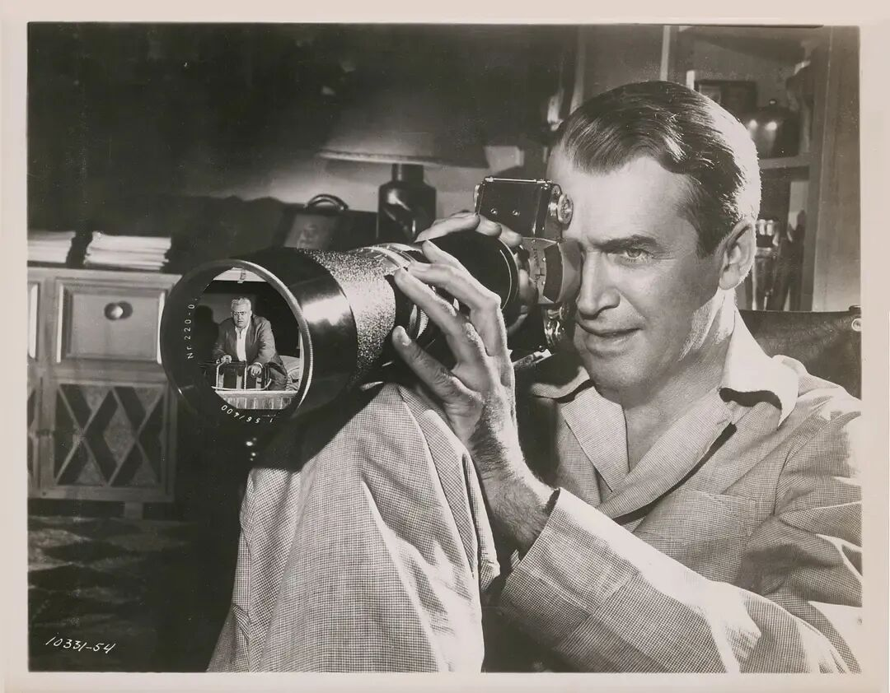
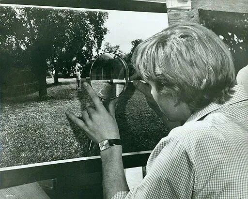
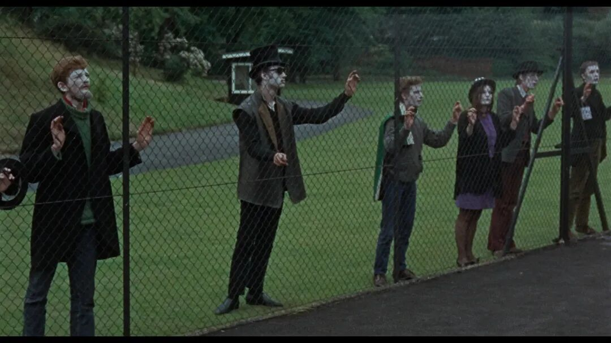
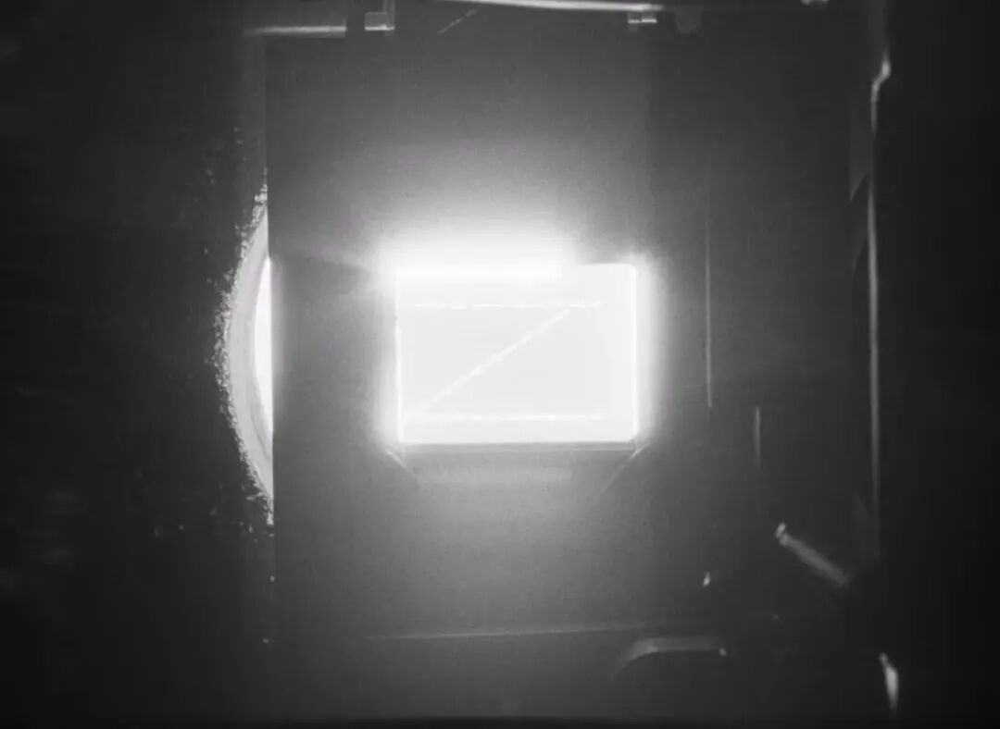
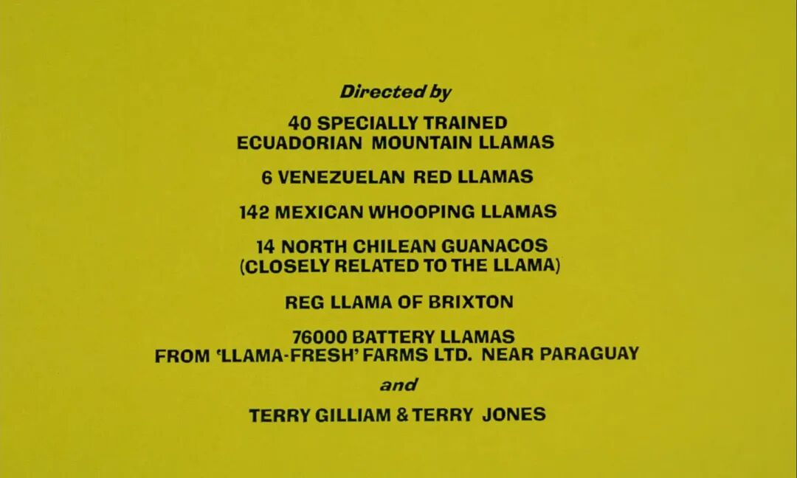
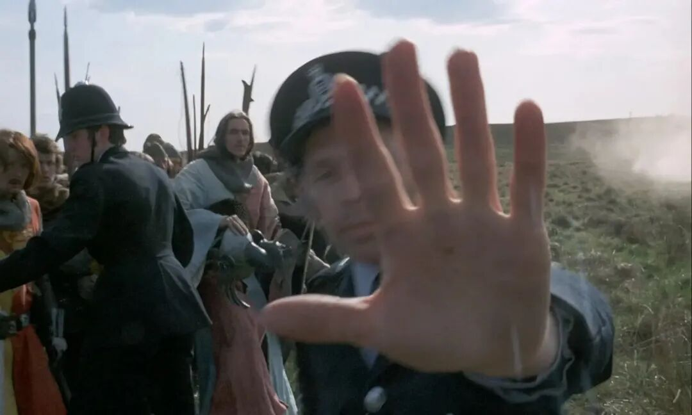
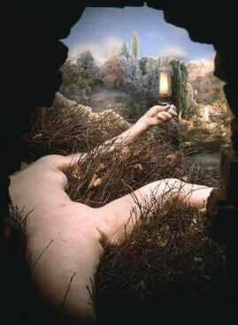
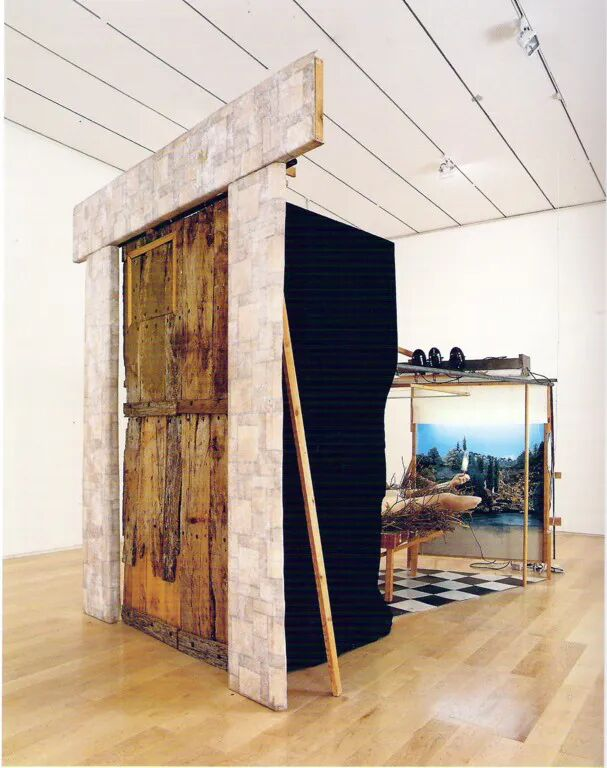
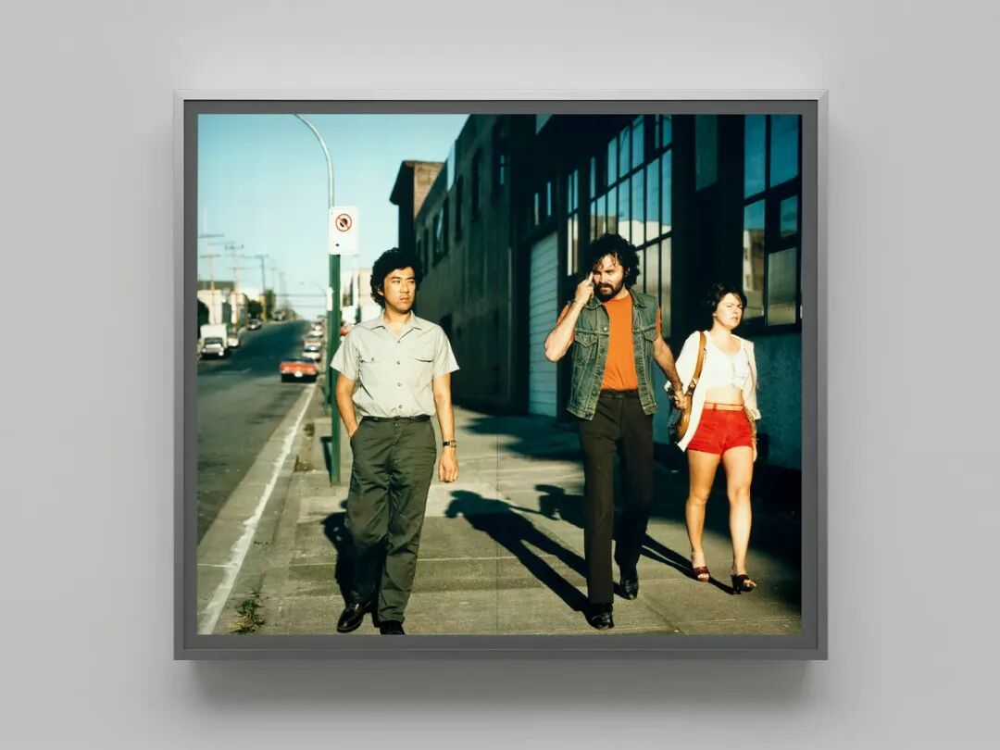
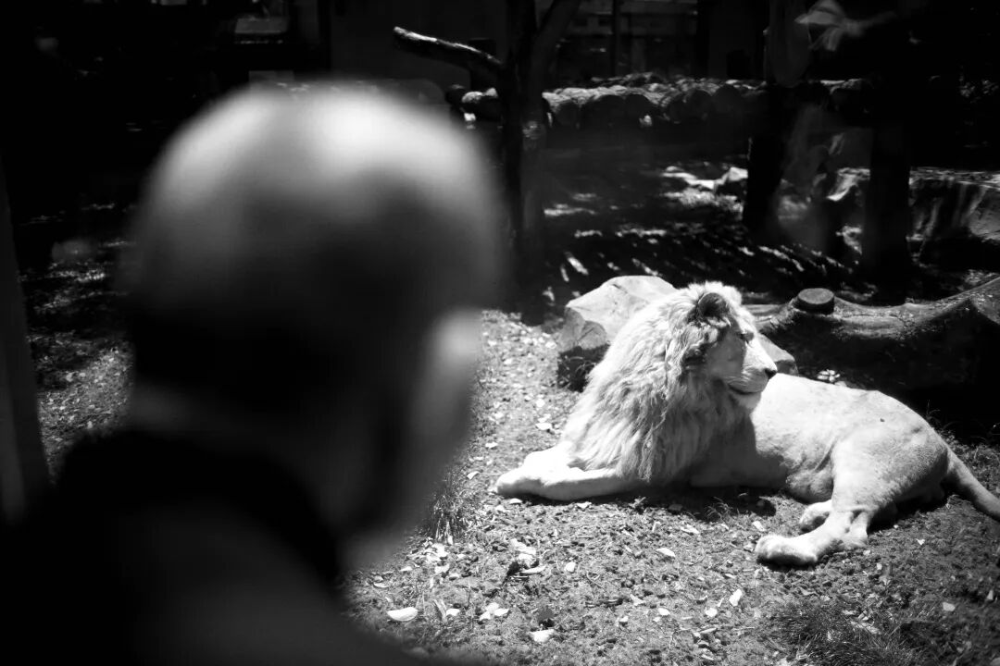

艺术可以做什么？这似乎是现代艺术一直在探索的问题，艺术家不断回答它，又打破答案，又不断提出新的回答。作为艺术形式的摄影也总在回答这个问题：摄影可以做什么？摄影可以记录事件、描绘人物和风景，也可以制造现实中并不存在的场景。摄影可以做什么？这个问题还没有一个确定的答案。

人们用眼睛看照片。人们看到了什么？我们看到一只猫、一群人、一座山、一条河、一片璀璨的星空。这是内容上的，可是，一张照片无论拍了什么，是挂在墙上、放到灯箱上，还是在屏幕上显示，都逃不过被观看。照相机用镜头观看，摄影者用取景器观看，观众用眼睛观看，照片和照片中的物体被观看。可是，这几种观看并不是同一种观看。

观看是所有以视觉为载体的艺术形式都很难绕过去的问题。

照相机只记录传感器内的东西，摄影者却可以选择照相机前面有什么内容。摄影者拍照时看到的是一个现实的世界，观众看到的却是被截取下来的一小部分。照片有自己的边界，边框之外是摄影者没有让我们看到的，但是世界并不会在边框外消失。

有人说，摄影的本质是记录。摄影者知道他在记录，但他们至少要明白：他不仅仅是在记录一个事件，也在通过自己的选择，影响这个事件将如何被人观看。观众至少也得明白：他不仅仅是在观看一个事物，他同时也在观看一张照片——一张纸，一块屏幕。这张纸内是摄影者选择让我们看到的，但还有更多东西，是他选择没有让我们看到的。

我认为，摄影在处理这个问题上可以向电影学习。

希区柯克的《后窗》（1954）讲述了一个观看的故事。主人公一条腿骨折，打上石膏，坐在房间里，拿着一台长焦照相机，通过窗子观察对面公寓的人们。他看见他们吃饭、生活、争吵，逐渐开始怀疑其中发生了一起谋杀。观众随着他一起观察、怀疑。然而主人公和观众看到的是全部吗？全片的摄影机几乎只限制在了主人公的公寓的视角之内，观众和主人公一起只能推测那些没有看见的事情。一扇扇窗户把每个房间分割成了画框，观众如同瘸了腿的主人公，被限制在了观看的位置上，我们一起以为在看一个故事，但自己看见的东西也经过了别人的选择。

  

Rear Window, 1954

  

安东尼奥尼在《放大》（1966）中提出了一个更复杂的问题，它与摄影直接相关。主人公是一名摄影师，他在公园里拍摄了一对男女，只是想得到几张普通的照片。回到暗房，他把照片冲洗出来，不断放大，逐渐发现照片里的公园里的树丛里藏着一个拿着枪的人，草地上好像躺着一具尸体。他在不知不觉中拍下了一场谋杀。摄影者拍下了他没有看到的东西。

但是，他真的看到了吗？他不断把照片放大，试图找到更多的证据。照片越来越大，原来清晰的景物变成了胶卷上银盐的颗粒。他在公园里确实找到了一具尸体，但是第二天尸体消失了，他的照片也被偷走了。他记录到了什么？影片没有给出明确的答案。

  

Blow-Up, 1966

  

如果说《后窗》的主人公不知道取景器外面发生了什么，那么放大的主人公甚至不知道取景器里面发生了什么！他拍下了照片，却完全不理解自己拍下的东西。照相机记录的东西甚至未必就是摄影者看到的东西，摄影者记录的东西甚至也未必是观众看到的东西。

《放大》的结尾同样引人深思，一群哑剧演员在没有网球的球场上打网球。主人公站在一边观看，后来那群演员要他捡起一个飞出球场、根本不存在的网球。他把这个不存在的球假装扔回球场，电影居然出现了网球被击打的声音，摄影师的身影从草地上消失。随后，电影结束。观众明明看见那里没有网球，又听到了网球的声音。前半部，摄影师努力通过照片确认现实中到底发生了什么。结尾，他却参与了一个根本没有实物存在的事件。我们是在根据眼睛看到的东西理解现实，还是也在组织自己所看到的东西？观看这一事件本身可以作为一个事件，并且是一个极其复杂的事件。

  

Persona, 1966

  

伯格曼的《假面》（1966）也探讨了观看这一过程。电影开始时，闪过几帧阳具的照片、一段被钉十字架的画面、一段伯格曼拍摄过的旧电影、一只蜘蛛、被宰杀的羊，这些全部和这部电影的主要内容没有任何联系。随后我们看到放映机和一连串胶卷。电影进行到一半时，画面如同突然损坏一样，中间破了个洞，胶片在屏幕中间燃烧起来。电影的结尾是放映机放到胶片末尾、灯光熄灭的影像。观众已经进入了电影的世界，但是导演提醒了他们，自己正在观看一部电影。电影不再仅仅是一个供人观看的故事会，它也让观看本身显露出来。

摄影者和导演必须意识到，有些东西观众看不到。我在看完《后窗》后，曾以为它是真实在纽约的公寓实地拍摄的，后来才知道巨大的布景是在好莱坞搭出来的。电影也可以主动拆解这层关系。

  

Monty Python and the Holy Grail, 1973

字幕意为：“导演：40只经过特殊训练的厄瓜多尔山地羊驼/6只委内瑞拉红色羊驼/142只墨西哥高声嚎叫羊驼/14只智利北部原驼（与羊驼有近亲关系）/来自布里克斯顿的雷格·羊驼/76,000只来自巴拉圭附近“羊驼鲜鲜农场有限公司”的笼养羊驼/以及/特里·吉列姆和特里·琼斯”

喜剧片《巨蟒与圣杯》的开头在演职员表的地方，安放了一大堆与电影毫无关联的内容，观众知道这是假的，但是他们理应相信。亚瑟王的侍从用两片椰子壳模仿马蹄声，原本用来制造电影幻觉的音效，成为了真实的东西。观众也理应相信，椰子壳就是一匹马。观众也理应知道，电影里没有任何马出现。电影的结尾，亚瑟王即将带领军队向城堡冲锋，随即现代的英国警察突然冲进画面，逮捕了他，用手挡住了镜头。影片就在胶片的末尾的黑片结束了。观众期待的故事结局没有出现，亚瑟王还没找到圣杯，因为电影被终止了。电影在提醒我们：你看见的不是中世纪、不是亚瑟王，而是一部电影。

电影可以这样对待自己的媒介、甚至嘲弄它，摄影也应当思考这些问题。一些摄影作品试图刻意取消摄影机的位置，想要达到忠实的、刻意的记录，仿佛摄影者隐形了一样，不去让观众意识这些问题。我认为，这是不可能的。一张照片的尺寸，出现的场景、顺序，甚至物理的载体，都应该是照片的一部分。摄影者可以拍摄风景、人物、街道，人们也可以仅仅是因为一张照片美丽而喜欢它。但是，摄影者至少应该知道，他此时此刻在做什么，照片不只是他所拍摄的东西。观众也至少应该知道，他此时此刻在做什么，他此时此刻看见的照片并不是全部。

  

Étant donnés, 1946-1966

  

观看本身是一种形式。杜尚用二十年完成了他最后一部艺术作品Étant donnés（1946-1966，暂译《给予》），他把一扇关闭的木门放在观众面前。门上有两个小孔，观众只有把眼睛凑近小孔，才能看见门后的景象。观看不再是一种任由观众自由选择的活动。观众必须站在特定的位置，以特定的姿势，才能看到艺术家允许他看到的东西。他不再仅仅是一个观众，而成为了一个窥视者。当他俯身向门内窥视时，也可能有另一个人正站在他身后，看着他窥视。艺术家安排的不只是他作品中的事物，也可以是观众与作品的关系，观看的行为也是作品的一部分。

  

Mimic, 1982

  

加拿大摄影师杰夫·沃尔（Jeff Wall）在1982年的作品Mimic（暂译《模仿》），是一张将近两米高、两米三宽的照片。此外，这张照片并没有被印在普通的相纸上，而是被制作成了灯箱中的透明正片。观众看到的不是一张反射外界光线的纸，而是一幅从内部发出光亮的巨大图像。画面中三个行人走在街道上，其中一名白人男子向旁边的亚裔男子做出侮辱性的手势。这似乎是一张普通的街头照片，但它的尺寸却极不普通。我第一次知道这张照片，是在叫《现代艺术150年》的一本书上看到的。当它被印在书上时，仅仅是一张普通的街头场景。但是，当它以几乎真人大小的尺度出现在美术馆里时，观众就不得不以另一种方式面对它。画面中的人物不再是几个小小的影像，而是几个仿佛与自己处在同一空间中的陌生人。观众可以站在远处观看整个场景，也可以走近观察其中一个人的表情和动作。照片里的人物甚至是他找来的演员，但观众也理应相信，这是真实的。尽管这张照片把纪实摄影最基本的理念颠倒了过来，观众可以像看电影一样去看一张精心设计的照片。

我第一次在书上看这张照片的时候，完全觉得没什么，因为我不知道它居然这么大。我没有机会去看原件，也就没法真正看过这个作品，因为我没有体验过它作为一件艺术作品的完整形式。

人们用眼睛观看照片。观看本身可以极其复杂，摄影者可以选择画面中的事物，也可以决定照片的尺寸、材料和展示方式，但他无法完全决定观众将看到什么。观众可以看见摄影者希望他看到的东西，也可能发现摄影者自己从未注意过的东西。

照片本身不是世界本身，也不只是一瞬间的定格。它还有自己本身作为照片的某些属性，我们观看照片中的内容，也在观看图像本身。摄影可以做什么？它不仅让我们看见某种事件，或许还可以让我们注意到，自己究竟是怎样看见这个事件的。

  

  

  

（这张图是我拍的）
