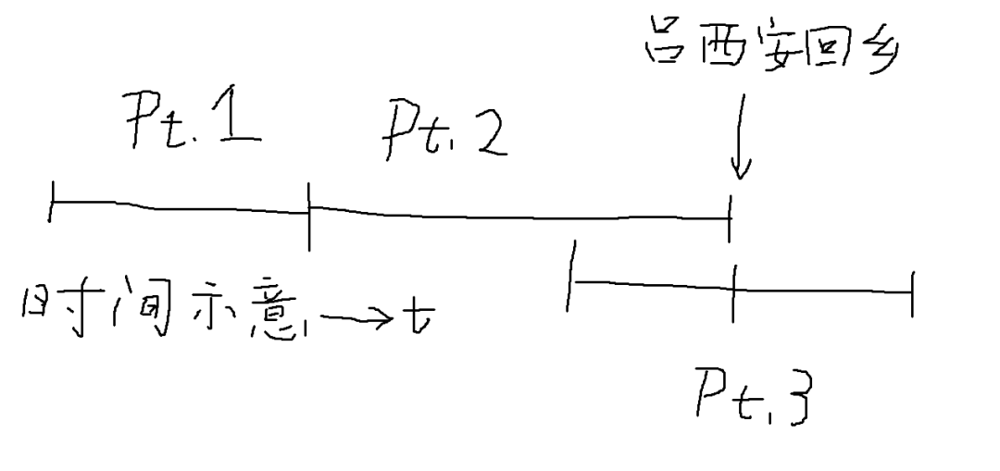

一年前这时候，我读了一本哲学书，雅斯贝尔斯的《时代的精神状况》。我写了一篇顶严肃的读后感，发在我的公众号上。过了一年，我居然一点也不记得当时写了什么，这本书讲了什么也全忘了。读书笔记、读后感，说是给自己写的吧，可我写完又不拿出来看。说是给别人写的吧，人家要是没读过这本书，我写的读后感就更读不下去了。我越来越觉得，对我来说，读书笔记是无用的东西，尤其是读文学、哲学这类书时写的笔记。

雅斯贝尔斯那本书讲了什么，我忘了，小说就更不用说了。一年前读过哪些小说，我都不记得了。所以我要趁着还记得，赶快记下来。

我把巴尔扎克的《幻灭》读完了。

一本书能让我有动力把它翻完，那就是好书。没这个动力，就是烂书。巴尔扎克的小说对我来说永远是好书。我小时候一晚上读完一本《查理九世》，那也是好书。

要是读一本书时，我还能和作者或书里的人物有那么一点共鸣，那就是好上加好了。过了许久，我已经忘了当时为什么会有这种认同感，只记得我曾有过。这样也足够了。

《幻灭》里的吕西安，说到底，也和我是同龄人。吕西安和觉得他们自己有那个能力，实际上他没有。后来出了那么多事，大丹士给夏娃写信，说吕西安有诗性，却做不了诗人。早在第二部开头，大丹士就那么劝吕西安不要做记者、不要进报界，别的朋友也左劝右劝，可他还是去了。罗斯多也跟吕西安唠叨了一堆，可吕西安这个人就是那么轴，非要试试不可。这些人把话说到这个份上，读者已经猜得到要出什么事了，可我们的主角却还是觉得自己有在报界混下去的本事。偏偏他起初还真混得不错，这下谁还劝得动他？读到大卫的故事，也一样叫人干着急。可干着急又没有用，惨事一件一件地发生，幻想一个一个地破灭。

珀蒂-克劳说吕西安，“难怪他有精神病，原来他是诗人！”我读到这儿又想起大丹士给夏娃的那封信。大丹士说他有诗性，却做不了诗人。就算吕西安当上诗人了，也是个精神病。

我喜欢这本书，还有一个原因，就是第二部写到吕西安回乡，第三部开头却把时间往前拨了一截。第二部后半和第三部开头，写的是同一段日子，一处写巴黎，一处写外省。巴尔扎克讲故事的快慢也有意思。写吕西安怎么爬上去，他用了大量笔墨，写吕西安的毁灭，篇幅却少得多。写大卫试制新纸也用了许多笔墨，可是等纸真造出来了，作者似乎就没什么可写了。

我觉得，一本书有没有主题，得看读它的人。读者读出来了，觉得它有，那就有。千读万读也读不出来，那对这个读者来说，它就没有。吕西安是这本书的主角，其实《人间喜剧》的主角只有一个，那就是钱。没有钱，这本书的情节可就玩不转了。从一个角度看，《幻灭》讲的是吕西安和大卫怎样试着在社会上得到点什么。换个角度看，这本书讲的是社会怎么从他们身上得到点什么！大卫忙着想怎么把纸造出来，别人也没闲着，想怎么从他的造纸法里赚钱。等他总算做成了，这发明究竟让谁得利，可就由不得他了。

哦，对了。译本（人民文学出版社，1978年）的前言说伏脱冷在《幻灭》里出场了。我看到最后也没看到他在哪里。后来查了一下才知道，《交际花盛衰记》里才交代，那个搭救吕西安、拿钱帮大卫的西班牙神父是他假扮的！译本序若是把全书的情节、人物的好坏，连作者在哪些地方用了什么笔墨，都交代尽了，那这个序言属实没有必要！至少也该改成跋。
